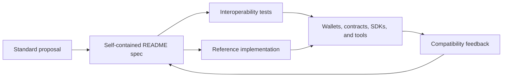

# xian-xips

`xian-xips` is the umbrella repository for **Xian Standards and
Improvement Proposals**. It hosts the public specifications,
reference implementations, and interoperability tests that other repos
across the Xian ecosystem implement and consume.

The repo currently focuses on contract standards under the `XSC` family,
but the scope is broader by design. Future families can cover protocol
behavior, governance processes, RPC / API conventions, wallet signing
formats, indexer and event schemas, and tooling interoperability.

## Standards Flow



## Quick Start

Browse a standard by directory. Each standard's directory contains:

- `README.md` — human-readable specification.
- a reference implementation (e.g. `XSC001.py`).
- `tests/` — Contracting-based interoperability tests describing the
  intended behavior of the standard.

To run the reference tests, see [Validation](#validation): `uv` builds the
test environment from the sibling `xian-contracting` and `xian-py` checkouts.

## Principles

- **Shared conventions only.** A proposal belongs here when it defines
  a stable, shared convention across the Xian universe — contract
  interfaces, behavior, signed message formats, event schemas,
  governance procedures, or other interoperability surfaces.
- **Out of scope: app-specific or private-deployment specifications.**
  Those live in the owning app or private repo.
- **Each standard is self-contained.** One directory per standard, with
  its own `README.md`, reference implementation, and tests.
- **Tests describe interoperability, not implementation choices.**
  Reference tests should pin the contract's externally observable
  behavior, not its internal storage layout.
- **Standards families are extensible.** Adding a new family
  (`XSC`, future families) does not change the role of the repository
  itself.

## Standards Families

| Family | Meaning                  |
| ------ | ------------------------ |
| `XSC`  | Xian Standard Contract   |

Additional families can be introduced as needed.

## Current Standards

| ID       | Title                       | Directory                                            |
| -------- | --------------------------- | ---------------------------------------------------- |
| XSC-001  | Standard fungible token     | [`XSC001_standard_token/`](XSC001_standard_token)    |
| XSC-002  | Permit authorizer (signature-based approvals) | [`XSC002_permit_authorizer/`](XSC002_permit_authorizer) |
| XSC-003  | Streaming token             | [`XSC003_streaming_token/`](XSC003_streaming_token)  |
| XSC-004  | Wrapped token               | [`XSC004_wrapped_token/`](XSC004_wrapped_token)      |
| XSC-005  | Non-fungible token          | [`XSC005_non_fungible_token/`](XSC005_non_fungible_token) |

## Repository Conventions

- Each standard lives in its own directory under the repo root.
- The directory contains a human-readable `README.md`.
- Reference implementations live alongside the `README.md`.
- Tests should describe interoperability behavior, not implementation
  detail.

## Validation

```bash
# From the repository root: storage-isolation checks plus every reference suite
uv run pytest tests/

# From inside a standard's directory:
uv run pytest tests/test.py
```

`uv run` creates and syncs `.venv` from `pyproject.toml` and `uv.lock` on
first use. The reference tests run on the local Contracting VM from the sibling
`../xian-contracting` checkout, and the XSC002 suite imports the wallet helper
from the sibling `../xian-py` checkout, so clone both next to this repository
first.

The root `pytest.ini` anchors test discovery at this repository, and
`conftest.py` configures disposable contract storage before test
collection, including tests run from a standard's directory. It leaves the
host node's state directory untouched. Run `pytest tests/` from the repository
root to check this isolation safeguard and run every standard's reference
suite in a separate subprocess. These checks verify storage isolation and
cleanup for the same child-directory invocation shown above.

## Related Docs

- [XSC001 — standard fungible token](XSC001_standard_token/README.md)
- [XSC002 — permit authorizer](XSC002_permit_authorizer/README.md)
- [XSC003 — streaming token](XSC003_streaming_token/README.md)
- [XSC004 — wrapped token](XSC004_wrapped_token/README.md)
- [XSC005 — non-fungible token](XSC005_non_fungible_token/README.md)
- [`../xian-contracting/README.md`](../xian-contracting/README.md) — contracting runtime that powers the reference tests
- [`../xian-contracts/README.md`](../xian-contracts/README.md) — curated contract hub that builds on these standards
